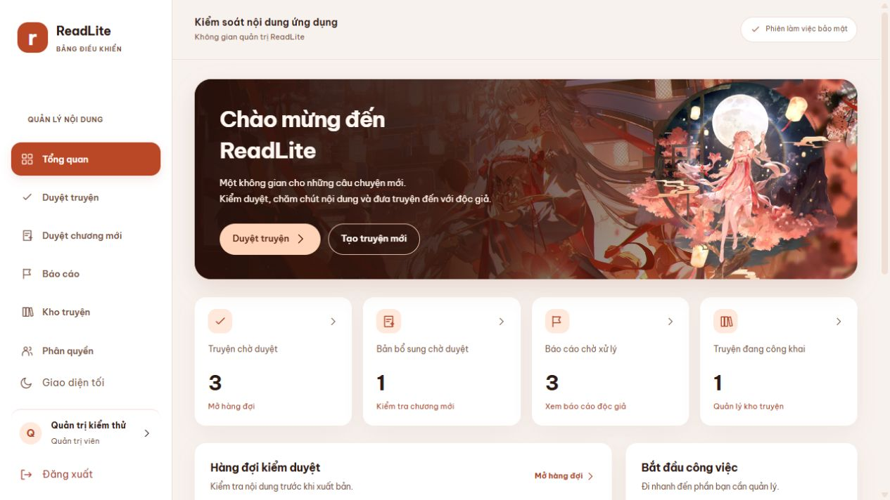

# Dashboard ReadLite theo mẫu profile wibu

## Thay đổi giao diện

Tham chiếu: `profile wibu.zip` do người dùng cung cấp ngày 30/10/2026. Mẫu là portfolio HTML/CSS/JavaScript, có nền kem, cam đào, banner anime và các khối nội dung bo tròn. ReadLite áp dụng ngôn ngữ thiết kế này cho công việc quản trị:

- Banner dùng ảnh `GiYf6zXaQAAviNN.jpg` từ ZIP, tối ưu thành WebP 1920 × 1080, khoảng 260 kB, kết hợp hình `Peach_Blossom_Splash_Art.webp` trên màn hình rộng. Chữ và nút là HTML; ảnh chỉ đóng vai trò trang trí.
- Bốn ô thống kê lấy số liệu từ các API hiện có. Khi chưa tải được, hiển thị dấu “—”, không thay bằng số 0.
- Hàng đợi và lối tắt quản lý nằm cạnh nhau trên màn hình rộng, xếp dọc khi thiếu chỗ.
- Menu, thanh đầu trang, nút, màu nền và phông chữ đồng bộ cho các trang quản trị/tác giả. Chuyển sang trang khác sẽ trở về đầu trang; liên kết mục trong cùng trang vẫn hoạt động.
- Có chế độ tối nâu ấm/cam đào, menu điện thoại thu gọn và trạng thái focus khi dùng bàn phím.

| Thành phần | Màu sáng |
| --- | --- |
| Nền chung | `#F8F2EE` |
| Khối nội dung | `#FFFFFF` |
| Nền phụ | `#FDF5F0` |
| Nhấn nhẹ | `#FFE9DC` |
| Nút chính / menu đang chọn | `#BA4827` |
| Chữ chính | `#2C1A14` |
| Chữ phụ | `#795344` |

## Phông chữ tiếng Việt

Dùng **Be Vietnam Pro** cho tiêu đề, nội dung và biểu mẫu. Bốn tệp phông được lưu trong `apps/web/src/assets/fonts`, gồm Regular, SemiBold, Bold và Italic. CSS tải phông từ chính bản web, không phụ thuộc yêu cầu Google Fonts lúc sử dụng. Trong lúc tải hoặc khi tải lỗi, dùng Segoe UI/sans-serif dự phòng.

Nguồn: [kho Google Fonts — Be Vietnam Pro](https://github.com/google/fonts/tree/main/ofl/bevietnampro). Giấy phép SIL Open Font License nằm ở `apps/web/src/assets/fonts/OFL.txt`. Đã kiểm tra các ký tự tiếng Việt viết hoa/viết thường, dấu dựng sẵn và dấu tổ hợp trong cả bốn tệp phông.

## Tệp giao diện chính

- `apps/web/src/App.tsx`: dashboard, điều hướng và thanh đầu trang.
- `apps/web/src/dashboard-theme.css`: phông, màu, bố cục, banner và các kích thước màn hình.
- `apps/web/src/styles.css`: các thành phần hiện có đã chuyển sang cùng họ phông.
- `apps/web/src/main.tsx`: nạp lớp giao diện mới sau kiểu dáng thành phần.

## Kiểm tra

Đã chạy 55 bài kiểm thử web, kiểm tra kiểu dữ liệu, lint và đóng gói bản phát hành. Đã xem giao diện trong trình duyệt ở kích thước mặc định, 820 px và 390 px, gồm chế độ sáng/tối, menu điện thoại, kho truyện và trang duyệt truyện. Không có tràn ngang tài liệu tại những kích thước đã kiểm tra.

Các bước xem lại trên dự án đang chạy:

1. Mở web và nhấn `Ctrl + F5` sau khi cập nhật mã.
2. Vào **Tổng quan**, kiểm tra banner và bốn ô thống kê; nhấn từng ô để tới đúng khu vực.
3. Đổi sáng/tối; thu nhỏ màn hình, mở menu rồi chuyển sang **Kho truyện** hoặc **Duyệt truyện**.
4. Xem các tiêu đề tiếng Việt có dấu, tên truyện dài và biểu mẫu tạo truyện.

Ảnh xem trước được chụp bằng dữ liệu kiểm thử tách biệt. Không sửa dữ liệu PostgreSQL, API hay mã Android trong đợt này; không cần migration.

## Ảnh xem trước

[Xem giao diện điện thoại](previews/dashboard-profile-wibu-mobile.jpg).
